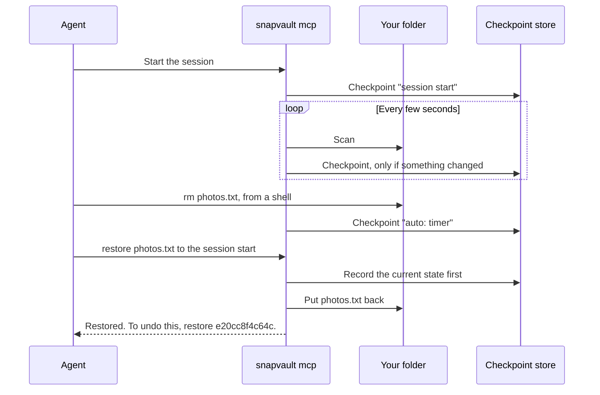
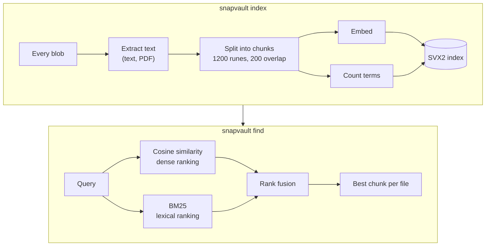
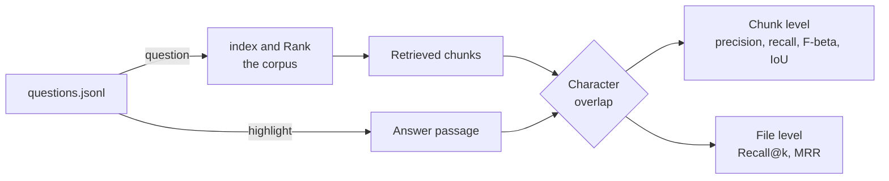
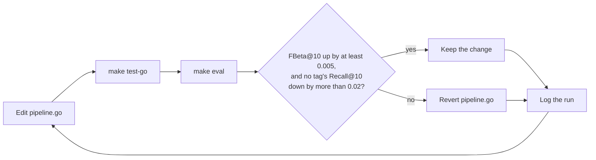
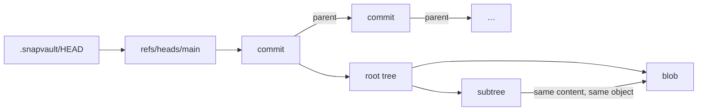
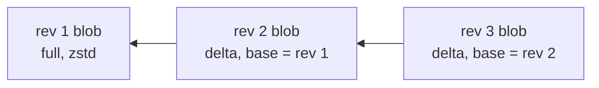
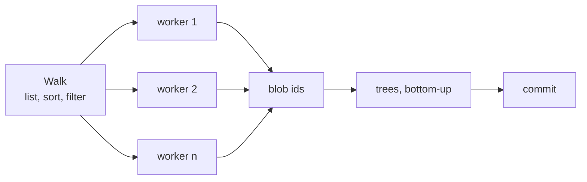

<div align="center">

<h1>SnapVault</h1>

<p>
<b>Git-style snapshots for any folder.</b><br>
Diff them, search them, restore any of them, and let an AI agent undo its own mistakes.<br>
Nothing leaves your machine.
</p>

[](https://github.com/Hussain0327/snapvault/actions/workflows/ci.yml)


<a href="#quick-start">Quick start</a> &nbsp;&nbsp;&nbsp;
<a href="#undo-for-ai-agents">Undo for AI agents</a> &nbsp;&nbsp;&nbsp;
<a href="#search">Search</a> &nbsp;&nbsp;&nbsp;
<a href="#how-storage-works">How it works</a> &nbsp;&nbsp;&nbsp;
<a href="#command-reference">Commands</a>

<br><br>


</div>

<br>

SnapVault is **one binary format with three implementations** that all read
and write each other's repositories, byte for byte.
I wrote the Java version first, froze the format, then rebuilt it in Go and
wrote a C++ verifier against the same spec.
If the spec is any good, three codebases in three languages should agree on
every byte.
They do, and CI checks that on every push.

| If you want to…                                                   | Start here                                                 |
| ----------------------------------------------------------------- | ---------------------------------------------------------- |
| Snapshot a folder and get any version of it back                  | [Quick start](#quick-start)                                |
| Undo what an AI agent did, including changes it made from a shell | [Undo for AI agents](#undo-for-ai-agents)                  |
| Find a passage in any old version of your files by meaning        | [Search](#search)                                          |
| Check whether search actually finds the right answers             | [Measuring search quality](#measuring-search-quality)      |
| See how three languages agree on one format                       | [Three implementations](#three-implementations-one-format) |

## Quick start

> [!NOTE]
> You need JDK 21+, Go 1.24+, CMake, a C++20 compiler, zlib, zstd, and
> `make`.

Build all three implementations and run their tests:

```bash
git clone https://github.com/Hussain0327/snapvault.git
cd snapvault
make
```

Snapshot a folder:

```bash
go/build/snapvault init ~/Documents/notes
go/build/snapvault -C ~/Documents/notes snapshot -m "before cleanup"
go/build/snapvault -C ~/Documents/notes log --oneline
```

After you change something, see what changed and restore a copy of the
snapshot somewhere else:

```bash
go/build/snapvault -C ~/Documents/notes diff
go/build/snapvault -C ~/Documents/notes restore HEAD --to ~/notes-before-cleanup
```

> [!TIP]
> `restore` without `--to` rewrites the folder itself.
> If the folder has changes you haven't snapshotted, it refuses until you
> add `--force`.

Watch the implementations read each other's repositories:

```bash
./java/snapvault -C ~/Documents/notes log --oneline    # Java reads the Go-written repository
cpp/build/snapvault-fsck ~/Documents/notes             # C++ verifies every object
make interop                                           # all 34 cross-language checks
```

## Undo for AI agents

Coding and computer-use agents edit real folders, and their built-in
checkpoints miss a lot.
Claude Code's own documentation lists what `/rewind` cannot undo: files
changed by Bash commands (`rm`, `mv`, `cp`), edits made by subagents,
changes made outside the session, and symlinked files.
`snapvault mcp` covers all of those, for any folder, with any agent that
speaks the [Model Context Protocol](https://modelcontextprotocol.io).

Register it with Claude Code for the folder you want protected:

```bash
make go
claude mcp add snapvault -- "$PWD/go/build/snapvault" -C ~/Documents/project \
    mcp --ignore node_modules --ignore .git
```

The agent's client starts `snapvault mcp` for the session, and it stops
when the session ends.
It checkpoints the folder at startup and then every few seconds, writing a
checkpoint only when something changed, so a file deleted from a shell is
caught even if the agent never calls a tool:



The agent gets four tools:

| Tool               | What it does                                                                                                                          |
| ------------------ | ------------------------------------------------------------------------------------------------------------------------------------- |
| `checkpoint`       | Records the folder now, with a reason, such as "before deleting build outputs".                                                       |
| `list_checkpoints` | Lists recent checkpoints with id, time, and reason.                                                                                   |
| `diff`             | Shows which paths changed between a checkpoint and now, or between two checkpoints.                                                   |
| `restore`          | Returns some paths, or the whole folder, to a checkpoint. The current state is recorded first, so every restore can itself be undone. |

This is a real session, driven over the stdio protocol, where the agent
deletes a file from a shell and then undoes it:

```text
list_checkpoints  e20cc8f4c64c  2026-09-24 16:27:19  auto: timer
                  5920759dba58  2026-09-24 16:27:18  auto: session start
diff              D photos.txt
restore           Restored photos.txt to checkpoint 5920759dba58.
                  To undo this, restore checkpoint e20cc8f4c64c.
```

> [!IMPORTANT]
> The checkpoint store lives outside the protected folder, so an agent's
> `rm -rf` on the folder cannot take its history with it.
> By default it's under `~/Library/Application Support/snapvault/stores/` on
> macOS and `~/.local/share/snapvault/stores/` elsewhere.
> The store records which folder it protects and refuses any other.

A checkpoint is an ordinary SnapVault commit, deduplicated like any other,
so a quiet folder costs nothing and a busy one costs only the bytes that
changed.
When a scan takes long, the timer backs off to at least ten times the scan
time.
Object writes are fsync'd before the rename that publishes them, so a
crash right after a checkpoint cannot leave a corrupt object behind.

<details>
<summary><b>Leave files out, and inspect checkpoints yourself</b></summary>

<br>

`--ignore` names a file or directory to leave out of checkpoints at any
depth; ignored entries are never snapshotted and never touched by a
restore.
Ignore rules exist only in these checkpoint stores, never in an ordinary
repository, so the three implementations still agree on every tree id.

The global `--store` option points any command at a checkpoint store, and
the C++ checker verifies one:

```console
$ go/build/snapvault --store <store> log --oneline
$ go/build/snapvault --store <store> diff
$ cpp/build/snapvault-fsck --store <store>
checked 5 objects: 0 errors, 0 warnings
```

</details>

<details>
<summary><b>Why the protocol layer has no dependencies</b></summary>

<br>

The protocol layer is written from scratch on the Go standard library
(`go/internal/mcp`): the initialize handshake with version negotiation,
`ping`, `tools/list`, and `tools/call`.
It adds no dependencies; the official Go SDK would have brought in eight
more modules, OAuth2 included, for a server that never touches the network.

</details>

## Search

`snapvault index` builds a search index over every blob reachable from
every ref, and `snapvault find <query>` searches it.
Both commands are Go-only.

```console
$ go/build/snapvault model pull potion-base-8M     # once; the only network call
$ go/build/snapvault -C ~/Documents/notes index --embedder static
indexed 412 blobs (1873 chunks) with static:potion-base-8M@f65d0f325faa

$ go/build/snapvault -C ~/Documents/notes find "when does the car insurance renew"
3726b03a0d95  finance/auto-policy.md  (snapshot: "before cleanup", 9b0084d65380)
    The automobile policy renews on 14 March; the premium is due ten days before ...
```

Ranking is hybrid.
Every chunk is scored two independent ways and the two rankings are fused,
so keyword queries keep working even against a semantic embedder's index:



Pick an embedder with `index --embedder`:

| Embedder         | Finds paraphrases ("car" for "automobile") | Needs                                       |
| ---------------- | ------------------------------------------ | ------------------------------------------- |
| `builtin`        | No, it matches words                       | Nothing. This is the default.               |
| `static`         | Yes                                        | One 30 MB download                          |
| `ollama:<model>` | Depends on the model                       | A local [Ollama](https://ollama.com) server |

`builtin` is `builtin-lexical-v1`, a deterministic hashed bag-of-words.
`static` is a pure-Go port of
[Model2Vec](https://github.com/MinishLab/model2vec)'s
`minishlab/potion-base-8M`: a static embedding table plus a WordPiece
tokenizer, with no model runtime.
`ollama:<model>` POSTs each chunk and query to
`http://localhost:11434/api/embeddings`, so nothing leaves the machine.

<details>
<summary><b>When to reindex, where the model lives, and what gets indexed</b></summary>

<br>

Reindex (`snapvault index`) after taking new snapshots, when switching
`--embedder`, or when `find` prints a note that the index was built with
different chunking settings.
`find` always resolves each hit to the newest snapshot that still contains
it, so an older index never points at a path that no longer exists.

The index is a sidecar at `.snapvault/index/embeddings.svi` (format
"SVX2"): it never touches `objects/`, `fsck` ignores it, and deleting it
only means the next `find` tells you to reindex.

The model lives under `$SNAPVAULT_MODEL_DIR/<name>` when that variable is
set, otherwise under the OS user cache directory
(`os.UserCacheDir()/snapvault/models/<name>`).
Its revision and every file's SHA-256 are pinned in
`go/internal/model2vec/registry.go` and verified before use, the same way
`java/Makefile` pins its one dependency.

Text extraction covers UTF-8 text and simple PDFs (via `pdftotext` when
it's on `PATH`, otherwise a small builtin extractor); anything else is
skipped and counted as skipped.

</details>

## Measuring search quality

"Semantic search" is a claim, so there is a harness to test it.
`tests/golden/search/` is a committed fixture: 50 original documents and
100 questions.
Each question names the exact passage (`highlight`) of a file that answers
it, and is tagged `lexical` (the answer shares the question's words),
`semantic` (the question paraphrases, "automobile" for "car"), or `hard`
(a distractor document on the same topic).
CI runs it as a quality floor for both embedders (`baseline.json`), so a
change that makes retrieval worse fails the build.

Results from `make eval` (k=10, β=2, 100 questions):

| Embedder                | Recall    | MRR       | Semantic recall | Semantic MRR | Lexical and hard recall |
| ----------------------- | --------- | --------- | --------------- | ------------ | ----------------------- |
| `builtin-lexical-v1`    | 0.880     | 0.784     | 0.701           | 0.593        | 1.000                   |
| `static:potion-base-8M` | **0.961** | **0.891** | **0.901**       | **0.802**    | 1.000                   |

Static embeddings find the paraphrased answers the keyword matcher misses,
with no loss on keyword queries.

> [!NOTE]
> `recall` is how much of the answer passage the retrieved chunks cover,
> and `MRR` is how high the right file ranked.
> Precision is about 0.07 for every embedder, because a 1200-rune chunk is
> much larger than a one-sentence answer, so compare embedders on recall
> and MRR.



<details>
<summary><b>Score your own files instead of the fixture</b></summary>

<br>

This needs a local Ollama model to write the questions; the scoring itself
never uses one:

```bash
ollama pull llama3.2:3b
go/build/snapvault -C ~/Documents/notes index --embedder static
go/build/snapvault -C ~/Documents/notes eval generate \
    --model llama3.2:3b --out ~/notes-questions.jsonl --per-file 2
go/build/snapvault -C ~/Documents/notes eval run \
    --questions ~/notes-questions.jsonl --embedder static
```

Generated questions carry no tag; add `"tags": ["semantic"]` and friends by
hand if you want the per-tag rows.
Every `highlight` must occur exactly once in its file's extracted text;
`eval run` refuses a question set that breaks that rule rather than
scoring it wrong.

</details>

<details>
<summary><b>Let an agent tune the search pipeline</b></summary>

<br>

`go/internal/search/pipeline.go` holds every tunable (chunk size and
overlap, BM25 `k1`/`b`, fusion method and weights).
The rules for changing it are in
[`docs/autoretrieval/program.md`](docs/autoretrieval/program.md), and
every run is logged to
[`experiments.md`](docs/autoretrieval/experiments.md).
Nothing is committed automatically.



Point a coding agent at it ("read `docs/autoretrieval/program.md` and run
one experiment"), then review `experiments.md` and the working tree.

</details>

## How storage works

Every file becomes a blob in a content-addressed object store.
Same content, same SHA-256, stored once, no matter how many paths or
snapshots contain it.
Trees capture directory structure (including symlinks, executable bits, and
empty directories), and commits chain the history together.



Objects are stored as `SHA-256("<type> <size>\0" + payload)`,
zlib-compressed.
Every read inflates the object, checks the declared size, rejects trailing
garbage, and recomputes the digest before trusting anything.
Full details and invariants are in [docs/FORMAT.md](docs/FORMAT.md).

### Format v2: delta compression and zstd

Format v2 adds a second, optional encoding for the same object file: a
later version of a file can be stored as a small delta against an earlier
version instead of a full copy, and either form can be compressed with
zstd instead of zlib.
Object ids never change; v2 is purely a smaller way to store the same
content.



An object file is one of two forms, and its first byte tells them apart:

| Form                | First byte           | Layout                                                                       |
| ------------------- | -------------------- | ---------------------------------------------------------------------------- |
| Legacy (v1 and v2)  | `0x78` (zlib)        | `zlib(canonical bytes)`                                                      |
| Container (v2 only) | `0x53` (`S` of SVO2) | `SVO2` magic, kind (full or delta), codec (zlib or zstd), compressed payload |

A full payload is the canonical bytes.
A delta payload is a 32-byte base id plus instructions in Git's own
pack-delta wire format: "copy N bytes from the base at offset O" and
"insert these literal bytes".
Reading still reconstructs the full canonical bytes (walking the base
chain, capped at depth 32) and recomputes the SHA-256 before trusting a
single byte.

`.snapvault/format` says `snapvault 1` or `snapvault 2`, and a v1
repository never gets a container-form object written into it.
Rewriting is opt-in:

- `snapvault upgrade` flips the format marker from 1 to 2 and rewrites
  nothing else, and running it twice is a no-op.
- `snapvault repack` is what actually shrinks a v2 repository.
  It groups versions of the same file and re-encodes each object as
  whichever of {current bytes, container-full-zstd, best
  container-delta-zstd} is smallest, rewriting an object only when that
  beats the current file by at least 5%.
  Every rewrite goes to a temp file, is decoded back and digest-checked,
  then fsync'd and renamed over the original, so an interrupted repack
  never leaves a corrupt object behind.

I measured `repack` on a 44 KB plain-text report, snapshotted 30 times
with one small realistic edit before each snapshot, on an M2 Air:

```console
$ snapvault -C repo upgrade
Upgraded repository to format 2
$ snapvault -C repo repack
repacked 28 objects: 153.6 KB -> 6.4 KB (96% smaller)
```

|               | Bytes on disk | Objects                             |
| ------------- | ------------- | ----------------------------------- |
| Before repack | 174,446       | 90 (30 blobs, 30 trees, 30 commits) |
| After repack  | 23,717        | 90, **86.4% smaller** overall       |

The 96% figure is the shrink on the 28 blobs repack rewrote; 86.4% is
across the whole object store, trees and commits included.
Thirty near-identical copies of one document is the best case for delta
compression, and it is one fixture on one machine, not a universal number.
The interop suite's own fixture, with larger edits, shrinks by 50.5%, and
CI asserts at least 50% on every run so a regression fails the build.

The repack took 0.41s.
Afterwards `snapvault-fsck` reported 0 errors across all 90 objects, a
second `repack` printed "nothing to repack.", `restore` reproduced the file
byte for byte, and the **Java** CLI read the Go-repacked repository and
printed "No changes." with an identical log.

<details>
<summary><b>Which zstd each language uses</b></summary>

<br>

zstd is a build dependency in every language, but not the same dependency:

- **Go** links `github.com/klauspost/compress`, a pure-Go implementation,
  pinned in `go.mod` and `go.sum`.
- **C++** links system `libzstd` (`brew install zstd` on macOS,
  `apt-get install libzstd-dev` on Linux); CMake fails loudly if it can't
  find it.
- **Java** only ever decodes zstd, via a pinned build of
  `io.airlift:aircompressor`, a pure-Java implementation.
  `make -C java deps` downloads that exact pinned jar into the gitignored
  `java/lib/` and verifies its SHA-256 before anything links against it,
  so a mismatched or tampered download fails the build instead of
  silently linking.

</details>

## Three implementations, one format

```text
snapvault/
├── docs/FORMAT.md    the format spec, the contract everything follows
├── java/             the original implementation (Java 21, one pinned dep)
├── go/               full rewrite with concurrent hashing (Go, one pinned dep)
├── cpp/              snapvault-fsck, an integrity checker (C++20, zlib + zstd)
└── tests/interop.sh  the script that proves they actually interoperate
```

The Java and Go CLIs take the same commands and print the same output for
everything both implement.
`upgrade`, `repack`, `index`, `find`, `model`, `eval`, and `mcp` are
Go-only, per the format v2 design.

### Go: concurrent hashing

Snapshotting is mostly hashing files, and hashing parallelizes well.
The Go version walks the tree sequentially, then feeds every file to a
worker pool (one worker per CPU, `--workers n` to override):



Each worker re-checks the file's size and mtime after hashing, so a file
rewritten mid-snapshot aborts the run instead of corrupting it.
Trees are built bottom-up after all hashing finishes, which is why the
resulting ids are identical no matter how many workers ran.

On an M2 (240 files × 128 KiB, hash-only scan):

| Workers | Time    | Throughput |
| ------- | ------- | ---------- |
| 1       | 23.4 ms | 1.3 GB/s   |
| 8       | 8.5 ms  | 3.7 GB/s   |

### C++: an integrity checker

`snapvault-fsck <directory>` (or `snapvault-fsck --store <store>` for an
agent checkpoint store) is read-only.
It walks every ref, inflates every reachable object, recomputes every
SHA-256, and validates tree and commit payloads against the spec.
Corruption, truncation, or a missing object exits 1.
Unreachable objects or an interrupted restore print warnings and exit 0.

It's stricter than the CLIs on purpose: it also rejects trees whose entries
aren't sorted, and sorted means *UTF-16 code-unit order* (Java string
order), which a byte-wise port silently gets wrong for characters outside
the Basic Multilingual Plane.
That one detail is pinned by golden test vectors generated from the Java
implementation and shared by all three test suites.

## How I know it works

`make interop` runs 34 cross-language checks on every push:

| Scenario                                 | What has to happen                                        |
| ---------------------------------------- | --------------------------------------------------------- |
| Java writes a repository                 | Go diffs it ("No changes.") and restores it identically   |
| Go writes a repository                   | Java diffs it ("No changes.") and restores it identically |
| Both snapshot the same content           | Both produce the exact same tree and blob ids             |
| `snapvault-fsck` checks both             | 0 errors, and a corrupted copy is rejected                |
| A v1 repository is upgraded and repacked | It still reads clean everywhere                           |
| A delta is corrupted                     | fsck and restore both reject it, in both languages        |

Each implementation has its own suite too:

| Command          | What it runs                                                               |
| ---------------- | -------------------------------------------------------------------------- |
| `make test-java` | A 41-test integration suite, format v2 included                            |
| `make test-go`   | gofmt, vet, and unit and integration tests, race-detector clean            |
| `make test-cpp`  | NIST SHA-256 vectors, golden payload parsing, and real-repository tests    |
| `make eval`      | Search scores for both embedders; CI enforces a floor from `baseline.json` |

### Shared golden vectors

Agreeing on well-formed input is the easy half.
`tests/golden/v2/delta/` holds checked-in `base`/`delta`/`target` triples
that all three suites read from disk and apply, so every implementation is
pinned to the same bytes rather than to its own idea of the format.
Alongside them, `reject/` holds malformed deltas that every implementation
must *refuse*: a copy that reaches past the end of the base, a truncated
instruction, a truncated varint header, the reserved opcode `0x00`, and
headers whose declared sizes disagree with reality.
Those cases ship without a `.target` file, because there is no correct
output for them.

<details>
<summary><b>Where the format was actually stress-tested, and the five bugs it found</b></summary>

<br>

I checked the delta encoding against Git's own `patch-delta.c` rather than
trusting my reading of it, and hand-decoded a golden vector byte by byte to
confirm the copy instruction consumes its offset and size bytes in the
right order.
That's the subtle part, since Git's delta size header uses a different
varint scheme than the offsets elsewhere in a packfile.

I also built a differential fuzzer: it generates malformed objects,
feeds each one to all three implementations, and compares their verdicts.
Across 919 generated cases there were no accept/reject disagreements, no
crashes, and no hangs; 479 malformed cases were rejected identically by
all three.
That campaign, plus an adversarial review pass, found five genuine bugs
worth naming, since they are the kind that a green test suite happily hides:

1. `repack` renamed a rewritten object over the original without an fsync.
   It is the only code path that overwrites a *good* copy of an object, so
   a crash at the wrong moment could leave a file that was neither the old
   bytes nor the new ones.
2. `repack` could build a delta cycle, destroying both objects involved.
3. The v2 writer accepted blobs larger than the 256 MiB read cap, storing
   objects that no reader could ever decode.
4. Java accepted v2 container objects inside a v1 repository, where Go and
   the C++ verifier both correctly refused them.
5. Java's delta size header decoded into a signed value, so a crafted
   length went negative and skipped the size cap entirely.

All five are fixed, each with a regression test.

</details>

## Command reference

<details>
<summary><b>Show all commands</b></summary>

<br>

```text
snapvault init [directory]
snapvault [-C directory] snapshot [-m message]
snapvault [-C directory] log [revision] [--oneline] [--limit n]
snapvault [-C directory] diff [from [to]]
snapvault [-C directory] restore <revision> [--to directory] [--force]
snapvault [-C directory] upgrade                   # v1 -> v2, idempotent
snapvault [-C directory] repack [--dry-run]        # shrink object storage
snapvault [-C directory] index [--embedder ...]    # build the search index
snapvault [-C directory] find <query> [--limit n]  # search indexed blobs
snapvault model pull <name>                        # the only network call
snapvault model list
snapvault [-C directory] eval run --questions <file> [--corpus <dir>]
    [--embedder ...] [-k n] [--beta f] [--pct n] [--json]
snapvault [-C directory] eval generate --model <ollama-model> --out <file>
    [--per-file n]
snapvault [-C directory] mcp [--store dir] [--interval 5s] [--ignore name]...
snapvault --store <dir> snapshot|log|diff|restore|upgrade|repack ...
```

</details>

Revisions are `HEAD`, `HEAD~2`, a full id, or a 7+ character prefix.
Restore verifies every object it needs before deleting anything, records
what it's doing so a crash mid-restore is recoverable, and refuses targets
that would eat your home directory or the repository itself.

## What's next

- [ ] Try smaller search chunks.
  Precision sits near 0.07 because a 1200-rune chunk is far larger than
  the passage that answers a question.
- [ ] Measure a full transformer embedder through `--embedder ollama:<model>`
  against `static`, to decide whether a reranker is worth building.
- [ ] Make `static` the default embedder if it keeps winning.
- [ ] Cache the BM25 index between queries instead of rebuilding it for
  each one.

## License

[MIT](LICENSE).
